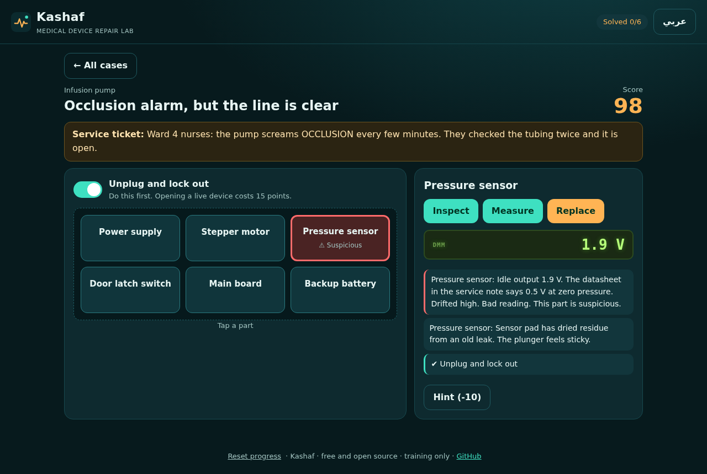
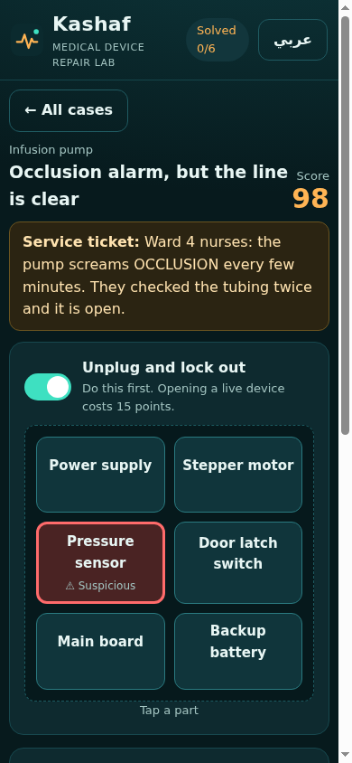
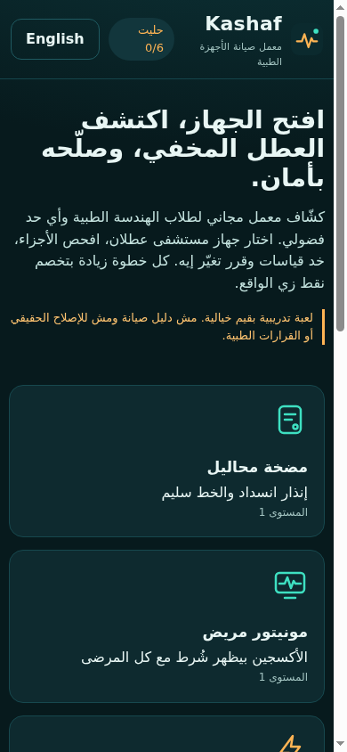
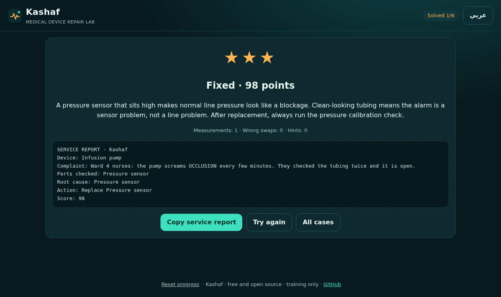

<div align="center">


# Kashaf · كشّاف

**A free browser lab where you repair virtual hospital devices. Find the hidden fault, fix it safely.**

[**Live demo**](https://yousefkhames.github.io/kashaf/) · English and Arabic · Works offline · No sign-up



</div>

> Training game with fictional values. Not a service manual and not for real repair or clinical decisions.

## What it is
You get a service ticket from a ward, for example "the infusion pump alarms for a blockage but the line is clear". You unplug and lock out the device, inspect parts, measure test points and decide what to replace. Wasted steps cost points. Opening a live device costs more. Parts that read normal are red herrings, so you have to reason, not guess.

Built for biomedical engineering students and anyone curious about how hospital equipment fails.

## Features
- 6 cases: infusion pump, patient monitor, defibrillator, suction pump, ECG machine, neonatal incubator
- Safety lockout step, digital multimeter display, hints, star rating, case of the day
- Copyable service report at the end of each case
- Full English and Arabic (RTL) interface, switch any time without losing progress
- Mobile first, keyboard and screen reader friendly
- Installable and offline capable (PWA), progress kept on your device
- Automated click-through test suite in `tests/`

| Mobile bench | Arabic home | Service report |
|---|---|---|
|  |  |  |

## Tech stack
Plain HTML, CSS and JavaScript. No framework, no build step, no dependencies, no tracking. Hosted on GitHub Pages.

## Run it
```bash
git clone https://github.com/yousefkhames/kashaf.git
cd kashaf
python3 -m http.server   # open http://localhost:8000
```
Run the tests: serve the folder and open `tests/index.html`. The page title shows PASS or FAIL.

## Add a case
Edit `cases.js`. Each case lists its parts (`comps`), one `fault` id, and bilingual `insp` (inspect) and `meter` (measure) texts.

## Honest limits
- Static site, so no accounts or shared leaderboard. Progress is stored in your browser only.
- Values and fault behaviour are simplified teaching examples, not real device data.
- Arabic text is written in Egyptian-friendly Arabic and has not had a professional review yet.

## License
MIT
